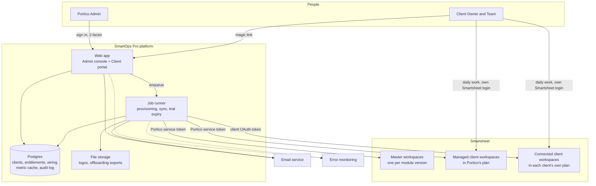

# 1. Architecture Overview

**Status:** Draft for review | **Brief:** v2, Section 12 item 1

## 1.1 The shape in one paragraph

SmartOps Pro is a small web application with a database and a background job runner. It holds the client list, entitlements and template definitions, and it drives Smartsheet through the API: copying a master workspace for each client, sharing it, and reading back a handful of numbers. Clients do their daily work in Smartsheet. They come to the portal to get started, find their links and see progress. Portico uses the admin console to onboard clients and watch the whole book of business.

## 1.2 Components

| Component | Responsibility | Does not do |
|---|---|---|
| **Web app** | Admin console (clients, modules, provisioning status, rollup, audit log) and client portal (welcome, links, progress, next step). One codebase, two route groups. | Never calls Smartsheet directly. Never holds a token. |
| **Job runner** | Every Smartsheet call. Provisioning, suspend, offboard, scheduled metric sync, trial expiry. Each job is a sequence of small steps with automatic retry. | No user-facing pages. |
| **Postgres** | System of record for the control plane. Row-level security for tenant isolation. | Does not store client row data from Smartsheet. |
| **File storage** | Client logos (theming), data exports produced at Managed offboarding. | |
| **Smartsheet** | System of record for daily operational data. Forms, sheets, reports, dashboards, automations. | |
| **Email service** | Magic links, welcome email, trial-ending notices. | |

## 1.3 How the main flows travel

**Onboard and provision (the "Monday afternoon" flow)**

1. Admin creates the client in the console: company, contacts, tier, module.
2. Console writes the client, a trial subscription and an entitlement, then enqueues a provisioning run.
3. Job runner copies the master workspace, confirms the copy, records every asset ID, shares users, runs checks, and does a first metric read. Each step is saved as it completes.
4. Console shows live step status. On success the client's users get a welcome email with a magic link.
5. Client lands in the portal and clicks through to their form, tracker and dashboard.

**Metric sync**

1. On a schedule, the job runner reads the one `Metrics` sheet of each active instance.
2. It stores the keyed numbers as a snapshot.
3. Portal tiles and the portfolio rollup read the latest snapshot. Neither waits on Smartsheet.

**Trial end**

1. A daily job finds trials that end today.
2. If not upgraded: client shares are removed, the instance is marked suspended, and the portal shows an upgrade page.
3. After the retention window, an admin-confirmed offboarding run exports and removes the workspace.

## 1.4 Where data lives

| Data | Lives in | Copied to the platform? |
|---|---|---|
| Friction items, initiatives, milestones, notes, owners | Smartsheet | **No** |
| Dashboard, reports, forms, automations | Smartsheet | No |
| Per-client numeric metrics (six for Challenge) | Smartsheet `Metrics` sheet | Yes, as numbers, for the portal and rollup |
| Client record, contacts, tier, source channel | Platform | |
| Subscription and entitlements | Platform | |
| Template definitions and versions | Repository (definition) and Smartsheet (master) | Published definition is stored in the database |
| Asset IDs and links for each client | Platform | |
| Smartsheet credentials | Platform, encrypted | |
| Audit log | Platform | |

## 1.5 Recommended stack

Chosen for one person plus Claude Code: managed services, no servers to patch, and the most widely documented tools available, so help is always easy to find.

| Layer | Choice | Why |
|---|---|---|
| Web app | **Next.js (TypeScript) on Vercel** | One codebase for console and portal. Deploys on every push. Preview links for review. |
| Database, auth, storage | **Supabase** | Managed Postgres with row-level security, magic-link sign-in, and file storage in one service. Fewer vendors to wire together. |
| Job runner | **Inngest** | Purpose-built for multi-step jobs that must survive a failure halfway. Each step is retried and remembered, which is exactly the provisioning requirement. Also handles the schedules. |
| Email | **Resend** | Simple transactional email with good deliverability. |
| Monitoring | **Sentry** plus an uptime check | Errors with context, and an alert if the site is down. |
| Smartsheet access | Official Smartsheet JavaScript SDK behind one internal client module | One place for rate limiting, retry and logging. |

Runner-up and full reasoning are in document 6, question 6. Costs are in document 9.

## 1.6 Design choices that keep this small

- **One application, not microservices.** The console and portal share models and deploy together.
- **Copy the master, do not rebuild it in code.** The platform orchestrates Smartsheet's own copy. It does not recreate sheets, forms or dashboards.
- **Read one sheet per client for metrics.** Sync cost stays flat no matter how large a client's sheets grow.
- **Provisioning state lives in our own tables**, not only inside the job tool. The admin console reads it directly, and the job tool can be swapped later without losing history.
- **Tier is resolved in one place.** The job runner asks "which connection does this instance use" and gets either Portico's token or the client's. The steps after that are the same.
- **Theme tokens from day one.** Colors, fonts and logo come from a theme record, so per-client branding later is a settings change.

## 1.7 Environments

| Environment | Purpose | Smartsheet target |
|---|---|---|
| Local | Development with Claude Code | A sandbox workspace, test token |
| Preview | Automatic per pull request | Same sandbox |
| Production | Live | Portico plan, service account |

Provisioning tests run against a small "test master" so a full copy can be exercised in seconds without touching real client workspaces.
