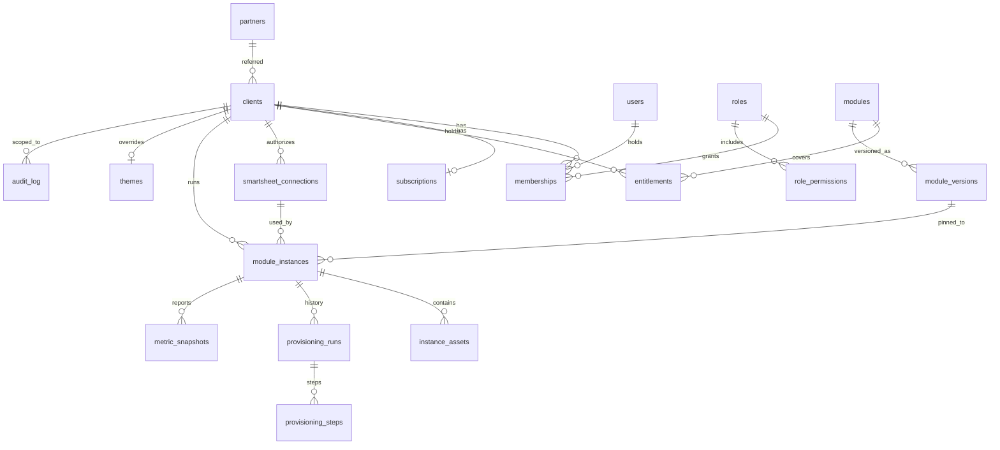

# 2. Data Model

**Status:** Draft for review | **Brief:** v2, Section 12 item 2

## 2.1 Principles

1. **Smartsheet holds the work. The platform holds the wiring.** The database stores who the client is, what they are entitled to, where their Smartsheet assets live, and a small cache of numeric metrics. It never stores row text from a client sheet.
2. **One database, shared tables, a `client_id` on every client-owned row.** Postgres row-level security (RLS) enforces isolation in the database itself, so a bug in application code cannot leak another client's rows.
3. **Tier is a column, not a fork.** `hosting_tier` lives on the client. Everything that differs by tier (which credential is used, who owns the workspace, what offboarding does) resolves through the `smartsheet_connections` table, so the provisioning and sync code has one path.
4. **Roles and permissions are data.** Adding a role is an insert, not a migration.
5. **Every record that feeds the portfolio rollup carries `client_id` and a source channel**, so direct, partner and referral business can be separated later.

## 2.2 Entity diagram

## 2.3 Tables

### Identity and access

| Table | Key columns | Notes |
|---|---|---|
| `users` | `id`, `email`, `full_name`, `last_sign_in_at` | Managed by the auth provider. One row per person, whichever side they are on. |
| `roles` | `key`, `scope` (`portico` or `client`), `label` | Seeded with `portico_admin`, `portico_consultant`, `client_owner`, `client_member`. |
| `permissions` | `key`, `description` | For example `client.create`, `instance.provision`, `portal.view`, `client_users.manage`. |
| `role_permissions` | `role_key`, `permission_key` | The mapping. New role means new rows here only. |
| `memberships` | `user_id`, `role_key`, `client_id` (null for Portico-wide roles), `status` | A Portico Consultant gets one membership row per assigned client. A partner user (post-MVP) gets a `partner_id` scope the same way. |

### Clients and commercial

| Table | Key columns | Notes |
|---|---|---|
| `clients` | `id`, `name`, `slug`, `industry`, `size_band`, `status`, `hosting_tier` (`managed` or `connected`), `source_channel` (`direct`, `partner`, `referral`, `webinar`, `other`), `source_detail`, `partner_id`, `primary_pain_point`, `handles_phi` (bool), `created_at` | `status` follows the journey already used in the Participant Registry sheet: `registered`, `active`, `complete`, `converted`, `suspended`, `offboarded`. |
| `client_contacts` | `client_id`, `name`, `email`, `title`, `is_primary` | People who are not yet portal users. |
| `subscriptions` | `client_id`, `plan_key`, `status` (`trial`, `active`, `past_due`, `canceled`), `trial_ends_at`, `setup_fee_cents`, `monthly_cents`, `editor_seats_included`, `billing_ref` | One per client. `billing_ref` stays empty until Stripe arrives. Prices are recorded so the model is honest before billing is automated. |
| `entitlements` | `client_id`, `module_id`, `status` (`active`, `suspended`, `ended`), `starts_at`, `ends_at`, `granted_by` (`trial`, `subscription`, `manual`) | The single question the code asks is "does this client have an active entitlement to this module right now". |
| `partners` | `id`, `name` | Post-MVP. The nullable `clients.partner_id` exists from day one so no migration is needed. |

### Modules and templates

| Table | Key columns | Notes |
|---|---|---|
| `modules` | `id`, `key` (`challenge`), `name`, `color_token`, `status` | The catalog. |
| `module_versions` | `module_id`, `version` (semver), `status` (`draft`, `published`, `retired`), `master_workspace_id`, `definition` (jsonb), `definition_checksum`, `published_at` | `definition` is the manifest described in document 4. A published version is immutable. |

### Smartsheet wiring

| Table | Key columns | Notes |
|---|---|---|
| `smartsheet_connections` | `id`, `owner` (`portico` or `client`), `client_id` (null when Portico), `auth_type` (`service_token` or `oauth`), `token_ciphertext`, `refresh_ciphertext`, `expires_at`, `smartsheet_user_email`, `status` (`active`, `revoked`, `error`), `last_verified_at` | Managed clients all point at the one Portico row. Each Connected client has its own row. Tokens are encrypted before they reach the database (document 5). |
| `module_instances` | `id`, `client_id`, `module_version_id`, `connection_id`, `status` (`pending`, `provisioning`, `active`, `suspended`, `failed`, `offboarded`), `workspace_id`, `workspace_permalink`, `config` (jsonb), `provisioned_at` | One row per client per module. Unique on (`client_id`, `module_id`) so a client cannot be provisioned twice. |
| `instance_assets` | `instance_id`, `asset_key` (for example `friction_log`), `asset_type` (`sheet`, `report`, `dashboard`, `form`), `smartsheet_id`, `permalink`, `column_map` (jsonb) | The portal builds its links from this table. `column_map` stores column IDs by stable key so sync survives a renamed column. |
| `provisioning_runs` | `id`, `instance_id`, `kind` (`provision`, `suspend`, `resume`, `offboard`, `upgrade`), `status`, `idempotency_key`, `started_by`, `started_at`, `finished_at`, `error` | One row per attempt to change an instance. |
| `provisioning_steps` | `run_id`, `step_key`, `status`, `attempt`, `output` (jsonb), `error`, `finished_at` | A step that has recorded its output is never executed again. This is what makes a half-failed run resumable. |

### Metrics

| Table | Key columns | Notes |
|---|---|---|
| `metric_snapshots` | `instance_id`, `client_id`, `metric_key`, `value` (numeric), `captured_at` | Numbers only. Append-only, one row per metric per sync. |
| `metric_latest` (view) | latest row per (`instance_id`, `metric_key`) | What the portal and the portfolio rollup read. |
| `sync_state` | `instance_id`, `last_synced_at`, `last_status`, `consecutive_failures`, `source_sheet_version` | Lets the sync skip a sheet that has not changed. |

Metric definitions (key, label, unit, how to aggregate across clients) live inside the module version's `definition`, so a new suite brings its own metrics without a schema change.

### Platform

| Table | Key columns | Notes |
|---|---|---|
| `themes` | `id`, `client_id` (null for the SmartOps Pro default), `tokens` (jsonb), `logo_path` | Document 6, question 9. |
| `audit_log` | `id`, `at`, `actor_user_id`, `actor_role`, `action`, `target_type`, `target_id`, `client_id`, `metadata` (jsonb) | Append-only. No update or delete grants for any application role. |

## 2.4 Tenancy and isolation

- RLS is **on for every table** that has a `client_id`. The default policy is deny.
- A client-side user can read a row only when a `memberships` row links them to that row's `client_id`.
- A Portico Consultant passes the same check, because their assignments are memberships too.
- A Portico Admin passes through a permission check, not a blanket bypass.
- Background jobs run with a service credential that bypasses RLS. That credential exists only on the server. Every job takes an explicit `client_id` and filters on it.
- The portfolio rollup is a view over `metric_latest` that only Portico roles may select from.
- An automated test signs in as client A and tries to read every table for client B. It must return zero rows, and it runs on every deploy.

## 2.5 How the model answers the entitlement question

A free trial, a paid subscription, and both hosting tiers use the same three records.

| Situation | `subscriptions` | `entitlements` | `module_instances` |
|---|---|---|---|
| Free-trial Challenge starts | `trial`, `trial_ends_at` = day 30 | `active`, `granted_by` = `trial`, `ends_at` = day 30 | `active` |
| Day 31, no upgrade | `canceled` | `ended` | `suspended` (shares removed, data kept for the retention window) |
| Day 31, upgrade | `active`, prices filled in | `active`, `granted_by` = `subscription`, no end date | `active` |
| Second suite added | unchanged, or new `monthly_cents` | new row for the new module | new row |
| Connected client cancels | `canceled` | `ended` | `offboarded` (connection revoked, workspace stays with the client) |

Seats are a number on the subscription (`editor_seats_included`), not a row per person. That matches how you described it (two or three editors per client, more on higher tiers) and avoids per-seat billing logic in the MVP.
