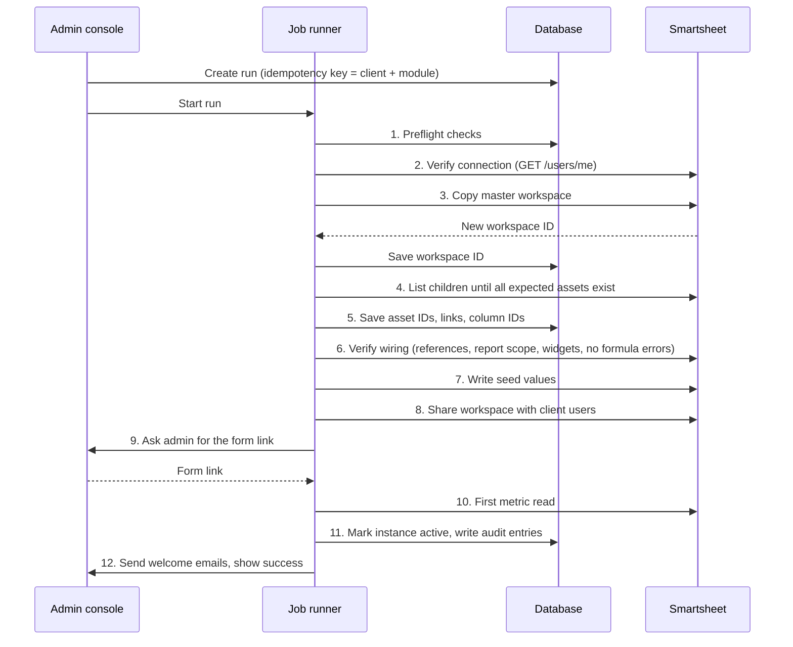

# 3. Smartsheet Integration Design

**Status:** Draft for review | **Brief:** v2, Section 12 item 3

## 3.1 How the API facts in this document were checked

The brief says to verify current API behavior and not assume. On November 17, 2026:

- **Read directly:** Smartsheet's official SDK source code on GitHub (Python 5.0.0, JavaScript 6.0.0, Java 5.0.0, all released November 16, 2026) and Smartsheet's own deprecation scanner. Your live Smartsheet account was inspected read-only.
- **Read through search extracts only:** Smartsheet's developer docs, help center and community. Those sites could not be opened from this session.
- **Not yet tested:** nothing was written to Smartsheet. Every behavior marked "confirm in Phase 0" below is checked by a throwaway script against a sandbox before any platform code depends on it.

Each fact carries one of three labels: **Confirmed** (in SDK code), **Documented** (search extract of official docs), **Unverified** (must be tested).

## 3.2 What the API can and cannot do

This table drives most of the design.

| Capability | API support | Label | Consequence |
|---|---|---|---|
| Copy a workspace with its sheets, reports, dashboards, forms, automations | Yes: `POST /workspaces/{id}/copy` | Confirmed | Provisioning is one copy call plus follow-up. |
| Re-point cross-sheet references, report sources, dashboard widgets to the new copies | Yes, by default | Documented, with user reports of failures in 2025 | **Every copy is verified afterwards.** |
| Create or edit a form | No | Documented | Forms can only arrive by copy. |
| Read a form's link | No endpoint found | Documented | **One manual step per client** (section 3.6). |
| Create a dashboard or edit its widgets | No. Only rename, copy, move, share, publish. | Confirmed for rename-only | Dashboards can only arrive by copy, and nothing on a dashboard may be client-specific. |
| Create and edit reports | Yes, new in 2026 | Confirmed | Useful for future template migrations. |
| Create automation workflows | No through REST | Documented | Automations can only arrive by copy. |
| Add columns, column formulas, cross-sheet references, summary fields | Yes | Confirmed | Additive template migrations are possible. |
| Share and unshare by email | Yes: `/shares` endpoints | Confirmed | Used at provisioning, suspend and offboarding. |
| Transfer ownership of a workspace to another organization | No API. Possible by hand in the Smartsheet app. | Unverified | "Go independent" for a Managed client is a guided manual hand-off. |

**This settles open question 2:** the master workspace must be copied. A template built purely from code cannot produce the form, the dashboard or the automations.

Two things changed in 2026 that the build must follow: the per-asset sharing endpoints and the old workspace listing endpoints were **removed on June 3, 2026**. The platform uses `/shares` and `/workspaces/{id}/children` only, through the current SDK.

## 3.3 Authentication

| | Managed | Connected (post-MVP) |
|---|---|---|
| Credential | One API token for a dedicated Portico **service account** | An OAuth grant from a named user at the client |
| Who owns the provisioned workspace | The service account | The client's authorizing user |
| Token life | Until rotated | Access token about 7 days. Refresh token is replaced on every refresh, so the new one must be stored each time. |
| Stored | Encrypted, one row | Encrypted, one row per client |
| Ends when | Portico rotates or deletes it | The client revokes the app, the client's admin sets a token expiry policy, or the platform calls the revoke endpoint |
| Region | Portico's (US) | Per client. Smartsheet's US, EU, AU and Gov regions are separate, with separate tokens and app registrations. The connection record carries a region. |

OAuth scopes requested from a Connected client, and no more:

| Scope | Needed for |
|---|---|
| `ADMIN_WORKSPACES` | Copy the master into their account |
| `READ_SHEETS` | Verify the copy, read the Metrics sheet |
| `WRITE_SHEETS` | Write seed values |
| `SHARE_SHEETS` | Share the workspace with their users |
| `READ_SIGHTS` | Verify dashboard widget sources |

Health check for both tiers: a daily `GET /users/me` per connection. A failure marks the connection `error`, pauses that client's sync, and raises an alert. It never retries blindly against a revoked grant.

## 3.4 Provisioning sequence

Each numbered step is saved with its output when it finishes. A re-run skips finished steps and resumes at the first unfinished one.

| Step | Detail | If it fails |
|---|---|---|
| 1. Preflight | Entitlement active. Module version published. No existing active instance for this client and module. | Stop with a clear message. Nothing was created. |
| 2. Verify connection | Token works and belongs to the expected user. | Stop. Mark connection `error`. |
| 3. Copy | `include` = `data`, `forms`, `rules`, `ruleRecipients`, `filters`, `cellLinks`, `brand`. Not `shares`, `attachments` or `discussions`. New name from the definition's pattern. | See 3.5. This is the only step that is not naturally repeatable. |
| 4. Wait for assets | List the new workspace's children. Compare against the definition. Retry with a short delay until complete or a time limit is reached. | After the limit, mark failed and offer Retry or Clean up. |
| 5. Record assets | Match each asset by its exact name to its key. Store ID, link and the column IDs the platform depends on. | A missing or duplicated name fails the run. This is why master names are frozen. |
| 6. Verify wiring | For each sheet: list cross-sheet references and confirm each points inside the new workspace. For each report: confirm its scope. For the dashboard: confirm each widget's source. Read Metrics and confirm no `#REF`, `#UNPARSEABLE` or blank keyed values. | Fail with the exact asset and reference named, so it can be fixed or reported. |
| 7. Seed | Write the values in the definition's `seed` section. | Retry. Writes to one sheet are sent one at a time to avoid save collisions. |
| 8. Share | Client users at the access level from the definition, by email. Portico Admin as Admin. `sendEmail` off, because the platform sends its own welcome email. | Retry. A client's Safe Sharing policy can block this in the Connected tier; the error is shown as is. |
| 9. Form link | Admin opens the copied Friction Log, copies the form link, pastes it into the console. | Run waits. Everything else is already done. |
| 10. First read | Read Metrics by key, store a snapshot. | Retry. |
| 11 and 12. Finish | Instance `active`. Audit entries. Welcome emails with magic links. | Retry. |

**Expected duration:** a few minutes of machine time for a workspace of this size, plus the one paste. Well inside the 15-minute target. Confirm in Phase 0.

**API calls per provisioning:** about 25 to 40. Not a rate-limit concern.

## 3.5 Making the copy step safe to retry

Copying is the one call that creates something new each time it is sent, and Smartsheet does not document whether the call finishes before it returns. So:

1. **Before the call**, the run records that a copy is about to start, with a unique run tag.
2. The copy is created with a **temporary name that contains the run tag**, for example `{client_name} | SmartOps Pro Challenge [run-7f3a]`.
3. **On retry**, before copying again, the job looks for a workspace whose name contains that tag. If one exists, it adopts it and continues. If it is incomplete past the time limit, it is deleted and the copy is repeated.
4. **After verification passes**, the workspace is renamed to its final name.
5. If Smartsheet returns error 1119 (partial copy), the response names the partial container. The job deletes it and retries.

The result: a run that dies at any point can be re-run, and a client never ends up with two workspaces.

## 3.6 The one manual step, and the alternative

Smartsheet has no API to read a form's link. Three options:

| Option | Admin effort per client | Tradeoff |
|---|---|---|
| **A. Paste the link once (recommended for MVP)** | About 30 seconds | Simple and honest. The console deep-links to the copied sheet and waits. |
| B. Portal-hosted intake form that writes rows through the API | None | Zero-touch and fully branded, but it rebuilds a Smartsheet form in code, must be rebuilt for each suite's forms, and stops working when a Connected client disconnects. |
| C. Skip the form link in the portal; link to the sheet | None | Weakest experience for the people logging friction. |

I recommend A now and B only if the paste proves annoying in the pilot. Phase 0 will also check whether any undocumented route to the form link exists.

## 3.7 Errors and retries

| Situation | Smartsheet signal | Platform response |
|---|---|---|
| Rate limited | HTTP 429, error 4003 | Wait at least 60 seconds, then retry. Honor a `Retry-After` header if one is sent (unverified). |
| Server busy or timeout | Errors 4001, 4002 | Exponential backoff with jitter, up to 5 attempts per step. |
| Save collision | Error 4004 | Writes to any one sheet are serialized. Retry with backoff. |
| Not authorized, token revoked | HTTP 401 or 403 | No retry. Mark the connection `error`, pause sync, alert. |
| Missing scope (Connected) | Error 4008 | No retry. Ask the client to re-authorize. |
| Sharing blocked by the client's policy | Errors 1376, 5151 | No retry. Show the message to the admin. |
| Not found | HTTP 404 | No retry. The asset was deleted or moved; flag drift on the instance. |
| Anything else | | No automatic retry. Fail the step, keep the run resumable, record the full error. |

Rules that apply everywhere:

- All Smartsheet calls go through **one internal module**. It applies the rate limiter, the retry policy, and logging without request or response bodies.
- A failed run always ends in a state the admin can act on: **Retry** (resume from the failed step) or **Clean up** (delete the partial workspace and reset the instance).
- Nothing destructive is retried automatically.

## 3.8 Rate-limit strategy

The limit is **300 requests per minute per token**. In the Managed tier every client shares Portico's one token, so the budget is shared.

| Activity | Calls | At 100 Managed clients |
|---|---|---|
| Metric sync, per client | 1 (read one sheet) or 2 (check version first, skip if unchanged) | 100 to 200 calls per sync cycle, spread over several minutes |
| Provisioning, per client | 25 to 40, over a few minutes | Rare. A handful per week. |
| Daily connection check | 1 per connection | 1 for all of Managed |

The limiter holds the platform to **120 requests per minute** on Portico's token, well under half the limit, which leaves headroom for your own work in Smartsheet and for other integrations on the same account. Sync cycles are spread across the interval so clients are not all read in the same minute. Provisioning takes priority over sync.

Connected clients each have their own token and their own 300 per minute, so they do not compete.

## 3.9 Metric sync

**Recommendation for the MVP: scheduled pull of one sheet per client, plus a refresh button.**

- Each module's master has a `Metrics` sheet with a `Metric Key` column and a `Value` column. The platform reads that sheet and stores the keyed numbers. It reads nothing else on a schedule.
- **Cadence:** hourly during business hours while a Challenge is active, every six hours otherwise, and daily for suspended instances that are still inside their retention window.
- **Refresh button** in the portal and console triggers an immediate read, limited to once every two minutes per client.
- The portal always shows "as of" the time of the last successful read.
- Three consecutive failed reads raise an alert and show a notice on the client's portal tiles instead of stale numbers presented as current.

| Approach | Freshness | Cost and complexity | Verdict |
|---|---|---|---|
| Scheduled pull | Up to an hour | Lowest. One call per client. Works identically for both tiers. | **MVP** |
| On-demand only | Instant when asked | Slow page loads, and the portfolio rollup would have nothing to read | Used only as the refresh button |
| Webhooks | Near real time | One webhook per sheet per client. Callbacks carry no data, so a read is still needed. OAuth revocation kills them permanently. Needs a public endpoint with signature checks. | Post-MVP, if clients ask for live numbers |

**Why read the Metrics sheet instead of calculating in the platform:** the Smartsheet dashboard needs those same numbers computed in the sheet anyway. Reading them means the portal and the dashboard can never disagree. Platform-only logic (benchmarks across clients, the rollup) is calculated from the stored snapshots.

**Confirm in Phase 0:** that a value read through the API reflects a form submission made minutes earlier when nobody has the sheet open.

## 3.10 Suspend, resume, offboard

| Action | Managed | Connected |
|---|---|---|
| **Suspend** (trial ended, payment lapsed) | List shares, delete every client share, keep Portico's. Instance `suspended`. Sync drops to daily. | Sync stops. Portal shows the upgrade page. The workspace is untouched because it is theirs. |
| **Resume** | Re-create shares from the membership list. | Sync resumes. |
| **Offboard** | Export each sheet to Excel into file storage, send the client a download link, remove shares, then delete the workspace after an admin confirms. | Call the token revoke endpoint, delete stored tokens, stop sync. The workspace stays with the client. |

Document 7 covers what data the platform retains afterwards.

## 3.11 Naming

| Item | Pattern | Example |
|---|---|---|
| Portico master | `PGI 20 SmartOps Pro \| <Suite> \| Master v<version>` | `PGI 20 SmartOps Pro \| Challenge \| Master v1.0.0` |
| Client workspace | `<Client Name> \| SmartOps Pro <Suite>` | `Acme Manufacturing \| SmartOps Pro Challenge` |
| Assets inside | Plain names, identical in every client | `Friction Log`, `30-Day Action Tracker`, `Metrics`, `Operational Snapshot` |

The client name comes first because that is what the client sees in their own Smartsheet, and because it sorts Portico's account by client. Asset names carry no client name, so references, reports and the definition's name matching work unchanged in every copy.

## 3.12 Phase 0 verification list

Each of these is a short script against a sandbox. Results are written back into this document before Phase 2 begins.

1. Copy the master through the API. Is the response complete when it returns, or does content arrive afterwards?
2. Are cross-sheet references, report sources and every dashboard widget pointed at the copy?
3. Do copied automations arrive enabled?
4. Does the copied form have a new link, and is there any API route to read it?
5. Does a `Metrics` read reflect a recent form submission with no sheet open?
6. Do share and unshare through `/shares` behave as documented for an external email address?
7. Is a `Retry-After` header sent on a 429?
8. Can a sheet be exported to Excel through the API under the service account?
9. Does the `brand` option carry workspace branding to the copy?

For the Connected tier, later: can a client's token copy a master that is shared to that client's user, what is the minimum share level on the master, and who owns the result.
